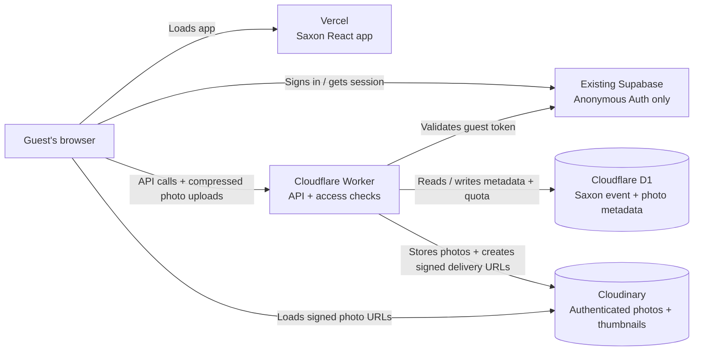

# Saxon Trip Camera

A mobile-first disposable camera for the Saxon trip. Guests get 24 shots; photos stay private until the shared reveal.

## System architecture



The browser never accesses D1 or Cloudinary's API credentials directly. Supabase is only used to create and verify anonymous guest sessions; Saxon does not read or write Halloween's Supabase database tables or Storage. Saxon event data is in the separate Cloudflare D1 database, while Saxon images are stored as private, authenticated Cloudinary assets.

This design shares the existing Supabase project for sign-in only; it does not require another Supabase project or a Supabase SQL migration. Existing Halloween photos remain where they are. The Saxon app does not copy, alter, or delete them.

## Cost and usage guardrails

- Cloudinary's Free plan has historically included 25 monthly credits shared across storage, transformations, and delivery bandwidth. Check Cloudinary's current [pricing](https://cloudinary.com/pricing) and your account's usage before relying on it; free-plan limits and terms can change.
- The app resizes each selected photo in the browser to a maximum 1920-pixel long edge and 750 KB, and creates a separate thumbnail capped at 480 pixels and 80 KB. Gallery grids load thumbnails; the full-size image is fetched only when opened or saved.
- The Worker enforces 24 photos per guest and a 512 MiB total Saxon storage cap, counting both originals and thumbnails. These are app-level safeguards, not Cloudinary billing controls, and do not limit how often guests view or download photos.
- Do not add a payment method unless you have checked the plan and are comfortable with its terms. Review Cloudinary's usage dashboard during the event. If the account reaches a limit, uploads or delivery may be restricted until usage resets or the plan changes.
- Cloudflare D1 and Workers have their own usage limits. Review the current [D1 pricing](https://developers.cloudflare.com/d1/platform/pricing/) and [Workers pricing](https://developers.cloudflare.com/workers/platform/pricing/).

## 1. Prepare Supabase Auth

1. Use the existing Supabase project; do not create another project.
2. In **Authentication → Sign In / Providers**, make sure **Anonymous Sign-Ins** is enabled. If it is already enabled for Halloween, leave it as it is.
3. In **Project Settings → API**, copy the project URL and the anon/public or publishable client key.
4. Do not run a Supabase schema or put a `service_role`/secret key in this app. Supabase is only used for guest sign-in.

## 2. Create and configure Cloudinary

1. Create a Cloudinary account and check the current Free plan terms and usage limits before uploading anything.
2. In the Cloudinary Console, copy the **Cloud name**, **API Key**, and **API Secret**.
3. Keep the API Secret private. Do not paste it into chat, commit it, put it in Vercel, or add it to `wrangler.jsonc`. It belongs only in the Cloudflare Worker's secret store.

## 3. Prepare Cloudflare D1 and the Worker

Install **Node.js 22 or newer** (required by the current Cloudflare Wrangler CLI), then in the repository terminal run:

```powershell
npm install
npx wrangler login
```

The D1 database `saxon-trip-db` has already been created for this branch. Its binding and ID are in `wrangler.jsonc`; do not create a second database. If you are setting up from a fresh repository copy without this D1 resource, create a database using `npx wrangler d1 create saxon-trip-db` and update the database ID in the config.

1. In `wrangler.jsonc`, set `SUPABASE_URL`, `SUPABASE_ANON_KEY`, `CLOUDINARY_CLOUD_NAME`, and `CLOUDINARY_API_KEY` to the values for your services. These are configuration values; do not put the Cloudinary API Secret there.
2. Add the exact origins allowed to call the Worker to `ALLOWED_ORIGINS`, separated by commas. Include `http://localhost:5173` for local work and the Saxon Vercel Preview origin (for example, `https://your-saxon-preview.vercel.app`). Do not include a path or trailing slash.
3. Add the Cloudinary API Secret to the Worker. Wrangler will prompt for the value:

   ```powershell
   npx wrangler secret put CLOUDINARY_API_SECRET
   ```

4. Apply the D1 migrations:

   ```powershell
   npm run worker:migrate:remote
   ```

   They create only Saxon D1 tables, add thumbnail and storage-accounting fields, and seed the reveal for **16 November 2026 at 3:00 pm Europe/Berlin**. They do not connect to or alter Supabase's database. If an earlier Saxon deployment already has photo records, the migration does not move its image files into Cloudinary; perform a fresh Saxon setup before guests upload photos.
5. Deploy the API:

   ```powershell
   npm run worker:deploy
   ```

   Copy the `workers.dev` URL printed by Wrangler.

## 4. Run locally

1. Copy the example environment files:

   ```powershell
   Copy-Item .env.example .env.local
   Copy-Item .dev.vars.example .dev.vars
   ```

2. In `.env.local`, set `VITE_SUPABASE_URL` and `VITE_SUPABASE_ANON_KEY` to the existing Supabase project values. Set `VITE_PARTY_API_URL=http://127.0.0.1:8787`.
3. In `.dev.vars`, set the Supabase URL and anon key, leave `ALLOWED_ORIGINS=http://localhost:5173`, and set `CLOUDINARY_API_SECRET` to the Cloudinary API Secret. `.dev.vars` is ignored by Git.
4. Apply the D1 migrations locally, then start the Worker:

   ```powershell
   npm run worker:migrate:local
   npm run worker:dev
   ```

5. In a second terminal, start the website:

   ```powershell
   npm run dev
   ```

Open the Vite URL and try one photo. To build-check the website and Worker types, run `npm run build`.

## 5. Connect the Saxon Vercel Preview

1. Push the `saxon-trip` branch to GitHub so Vercel has its latest code.
2. In the Vercel project, open **Settings → Environment Variables**. Add these variables for **Preview** deployments, restricted to the `saxon-trip` branch if Vercel offers that option:
   - `VITE_SUPABASE_URL` — the existing Supabase project URL.
   - `VITE_SUPABASE_ANON_KEY` — the existing anon/publishable key.
   - `VITE_PARTY_API_URL` — the deployed Cloudflare Worker `workers.dev` URL.
3. Do not change the existing **Production** variables or production branch; Halloween remains on `main`.
4. Make sure the Saxon Preview origin is included in `ALLOWED_ORIGINS` in `wrangler.jsonc`, then redeploy the Worker with `npm run worker:deploy` if you changed it.
5. Redeploy the Saxon Preview so Vercel builds with the new variables. Test a photo upload, confirm its metadata appears in the D1 `photos` table, and confirm the private assets appear in Cloudinary.

## Event settings and privacy

- The D1 migration seeds the event reveal at `2026-11-16T14:00:00.000Z` (3:00 pm Berlin time). To change it after deployment, update the `saxon-trip` row in D1—not Supabase—and keep the stored timestamp in UTC.
- Each authenticated guest can upload at most 24 photos. Each original is compressed to at most 750 KB and its thumbnail to at most 80 KB; Cloudinary's reported bytes count toward the Worker's 512 MiB Saxon storage cap.
- Cloudinary assets use the `authenticated` delivery type. The Worker generates signed delivery URLs; anyone who receives a URL can use it, so do not share photo links publicly. The Cloudinary signature is not a substitute for guest identity or a link-expiration mechanism.
- Before reveal, the API issues links only for a guest's own photos. After reveal, guests with the event link can open the gallery.
- `wrangler.jsonc` is intentionally committed: the D1 database ID, Cloudinary cloud name/API key, Supabase project URL, and anon/publishable key are configuration/public identifiers. Never put a Supabase `service_role` key, Cloudflare API token, or Cloudinary API Secret in this file. `.dev.vars` and the Worker secret are not committed.
- Guest identity is browser-based. Clearing browser data or switching devices may create a new anonymous guest account.
- The preview image is separate from guests' uploads. To add it, put `IMG_7897.jpg` in `public/photos/`.
